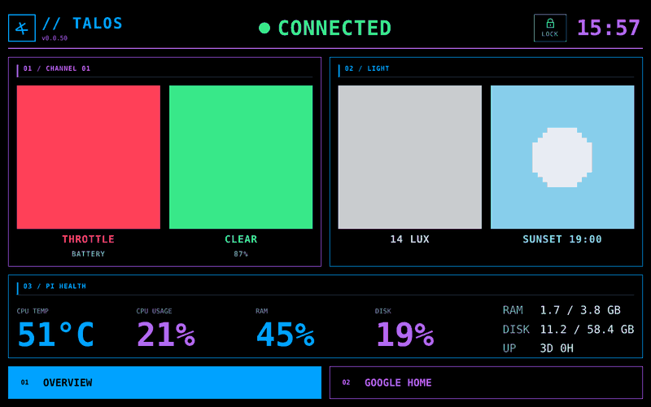
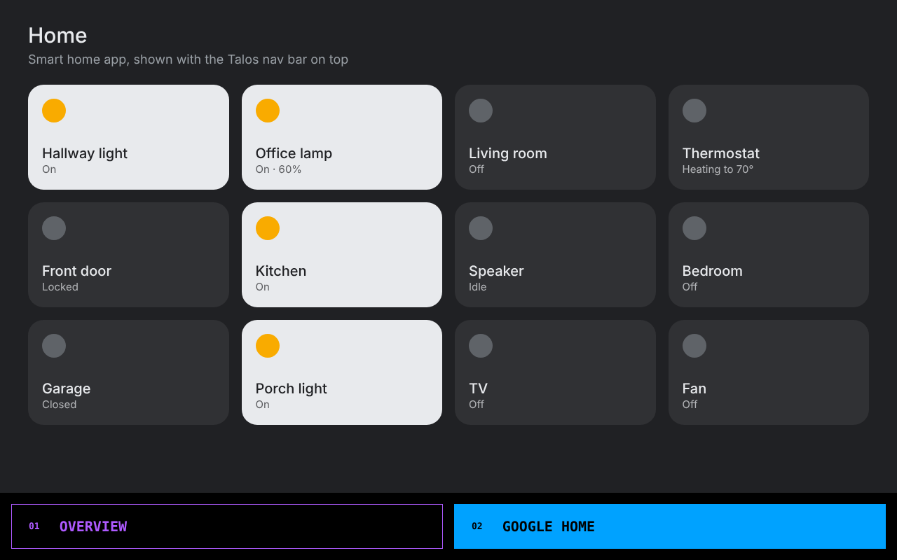

# Talos

A touchscreen home hub for a Raspberry Pi: live sensor status, system health, and a passcode lock, with Google Home one tap away. Built with the Python standard library and plain HTML, CSS and JavaScript, with no frameworks.

**[Live demo](https://h4d33d.github.io/REPO-NAME/static/)** (runs in your browser!)



## Google Home integration

The Pi's screen runs a full-screen GTK/WebKit window for the dashboard. Google Home runs as a separate Chromium app window, and a thin GTK layer-shell nav bar stays on top of it, so you can always get back to the dashboard.

- **Preloaded:** Google Home opens in the background at start-up, so switching is instant.
- **Minimised, not closed:** it keeps its state between visits.
- **Idle return:** after a set time without a touch, Talos returns to the dashboard and locks. Touches are tracked as timestamps only, with no input content stored.
- **Restart:** one button in the Quick Access menu closes the window and opens a fresh one.
- **Window control:** `wlrctl` finds, focuses and minimises the window on Wayland (`app.py`).



## Dashboard


- **Channel 01:** two status squares from an Aqara FP300 presence sensor (motion, and presence held for 10 s or more) with its battery level
- **Light:** hallway lux, and a sun or moon with the next sunrise or sunset
- **Pi Health:** CPU temperature and usage, RAM, disk, uptime
- **Lock:** passcode keypad, with the dashboard still live behind it
- **Controls:** restart Google Home, fullscreen, restart or shut down the Pi, sleep clock

## How it works

```
Zigbee sensor ──► zigbee2mqtt ──► MQTT ──► server.py ──► /api/status ──► browser page
Linux /proc, /sys ─────────────────────────┘    ▲
Sun position (location + time) ─────────────────┘
```

- `server.py` listens to the sensor over MQTT, applies the status rules, and serves one JSON endpoint that the page polls once a second.
- Retained (stored) MQTT messages give lux and battery at start-up but never count as motion.
- Sunrise and sunset are calculated offline with the NOAA solar equations, with no API call.
- The passcode is stored only as a salted PBKDF2-SHA256 hash. Five wrong tries start a 10-minute break, and the server refuses settings and Pi controls while locked.
- Pi actions (restart, shut down, screen off) go through one fixed root helper that `sudo` allows only for those three commands.
- The browser demo works because `demo.js` answers the same `/api/...` calls in the browser with simulated data.
- Unit tests cover the sensor rules, sun maths, Pi health parsing and the lock.

Full walkthrough: [CODEBASE.md](CODEBASE.md)

## Run it

Needs Python 3.9 or newer.

```bash
python3 server.py --demo
```

Then open http://127.0.0.1:8090. On a Pi: `sudo bash install.sh`. Tests: `python3 -m unittest discover -s tests -t .`

Raspberry Pi 4 · 1280×800 touchscreen · Zigbee USB coordinator · Aqara FP300